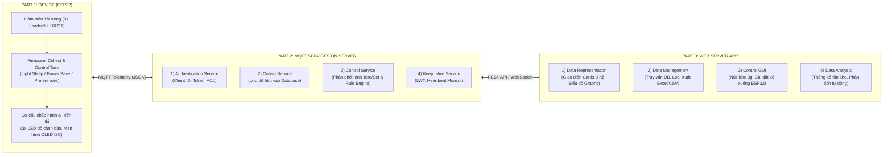

# 📑 TÀI LIỆU TỔNG HỢP KIẾN TRÚC HỆ THỐNG IOT VÀ DANH SÁCH THIẾT BỊ (BOM)

> **Dự án:** Hệ thống Giám sát & Điều khiển IoT Đa Tầng (ESP32 - MQTT - Web Application)  
> **Tác giả / Nhóm thực hiện:** Nhóm 22  
> **Nền tảng:** PlatformIO / ESP32 / HiveMQ MQTT / Node-RED & Web Dashboard  

---

## 📌 PHẦN A: NỘI DUNG CHI TIẾT 3 TẦNG KIẾN TRÚC HỆ THỐNG



---

### 1. PART 1: DEVICE (ESP32) – TẦNG THIẾT BỊ ĐẦU CUỐI
* **1) Firmware (Phần mềm nhúng):**
  * **Collect Task (Tiến trình thu thập dữ liệu):**
    * Đọc dữ liệu từ **3 bộ cảm biến tải trọng Loadcell** qua chip ADC 24-bit **HX711** cho 3 kệ hàng (K1, K2, K3).
    * Áp dụng bộ lọc số (lấy trung bình mẫu) để loại trừ rung động cơ học, tính toán ra khối lượng thực tế (gram).
    * Tính toán số lượng sản phẩm tức thời: $\text{Số lượng} = \frac{\text{Tổng khối lượng}}{\text{Khối lượng 1 đơn vị}}$.
    * Đóng gói payload JSON chứa thông tin chi tiết cả 3 kệ hàng và gửi (Publish) lên MQTT Broker qua topic: `nhom22/smartshelf/telemetry`.
  * **Control Task (Tiến trình điều khiển & cảnh báo):**
    * Đăng ký lắng nghe lệnh từ topic điều khiển: `nhom22/smartshelf/cmd`.
    * **Lệnh Tare (về 0g):** Hiệu chuẩn điểm không cho từng kệ khi thay đổi khay đựng.
    * **Lệnh Set cấu hình:** Cập nhật tên sản phẩm, trọng lượng đơn vị, ngưỡng tối thiểu và tự động lưu vào bộ nhớ Flash (`Preferences`).
    * **Điều khiển LED cảnh báo tại chỗ:** Tự động bật sáng LED đỏ tương ứng với từng kệ khi số lượng bị giảm dưới ngưỡng tối thiểu (`low_stock = true`), tắt khi đã bổ sung hàng.
    * **Cập nhật màn hình OLED (SSD1306):** Hiển thị trực quan trạng thái Wi-Fi/MQTT, số lượng và khối lượng 3 kệ tại hiện trường.
  * **Power Save & Light Sleep (Tối ưu hóa năng lượng):**
    * **Modem Sleep:** Tắt khối thu phát RF Wi-Fi giữa các chu kỳ gửi tin (giảm dòng từ 120mA xuống 20–30mA).
    * **Light Sleep:** Đưa CPU vào chế độ ngủ nhẹ, giữ RAM, đánh thức định kỳ bằng RTC Timer (tiêu thụ ~1–2mA).
* **2) Design Hardware (Thiết kế phần cứng):**
  * **Mạch in (PCB):** 
    * Khối nguồn 5V/3.3V cấp cho vi điều khiển ESP32 và 3 module HX711.
    * Mạch đệm điều khiển 3 LED đỏ qua điện trở hạn dòng 220Ω bảo vệ chân GPIO.
    * Cổng cắm I2C cho màn hình OLED 0.96 inch.
  * **Hộp bảo vệ & Khung kệ:**
    * Khung bàn cân mica hoặc gỗ cắt CNC làm 3 tầng kệ để gắn chắc chắn 3 cảm biến Loadcell.
    * Vỏ hộp chứa mạch ESP32 gọn gàng, có lỗ đưa màn hình OLED và đèn LED ra ngoài.

---

### 2. PART 2: MQTT SERVICES ON SERVER – TẦNG DỊCH VỤ TRUNG GIAN
* **1) Authentication Service (Xác thực & Bảo mật):**
  * Cấp quyền định danh thiết bị bằng `Client ID`, `Username/Password` hoặc chứng chỉ số `mTLS`.
  * Phân quyền truy cập theo ACL (Access Control List): Thiết bị A chỉ được Publish vào `device/A/telemetry` và Subscribe `device/A/cmd`.
* **2) Collect Service (Thu thập & Lưu trữ dữ liệu):**
  * Tiến trình chạy ngầm (Node-RED flow hoặc backend daemon) subscribe topic telemetry `nhom22/smartshelf/telemetry`.
  * Xác thực tính toàn vẹn của dữ liệu và ghi lịch sử các lần đo vào Database (MySQL, InfluxDB, MongoDB).
* **3) Control Service (Điều phối lệnh & Cảnh báo):**
  * Tiếp nhận yêu cầu điều khiển từ Web App (REST API hoặc WebSocket), chuyển đổi sang bản tin MQTT và publish xuống topic lệnh `nhom22/smartshelf/cmd`.
  * Tích hợp dịch vụ gửi tin nhắn cảnh báo qua **Telegram Bot API** tự động nhắc nhở người quản lý kho khi có kệ bị thiếu hàng.
* **4) Keep_alive Service (Giám sát trạng thái sống/chết):**
  * Ứng dụng cơ chế **LWT (Last Will and Testament)** của MQTT: Khi ESP32 mất nguồn hoặc mất Wi-Fi đột ngột, Broker tự động gửi thông báo Offline lên Web Dashboard.

---

### 3. PART 3: WEB SERVER APP – TẦNG ỨNG DỤNG & GIAO DIỆN NGƯỜI DÙNG
* **1) Data Representation (Trực quan hóa dữ liệu):**
  * Dashboard hiển thị 3 thẻ Kệ hàng (Coca, Bánh Oishi, Mì Hảo Hảo) với tải trọng, số lượng, thanh % lấp đầy và badge trạng thái.
  * Biểu đồ đường thời gian thực (Chart.js) cập nhật mượt mà biến thiên khối lượng và số lượng.
* **2) Data Management (Quản lý dữ liệu & Truy vấn Database):**
  * Lưu trữ dữ liệu lịch sử đo đạc vào bộ nhớ trình duyệt (LocalStorage / Database).
  * Bộ lọc tìm kiếm theo kệ hàng, trạng thái thiếu hàng và nút xuất file Excel/CSV.
* **3) Control GUI (Giao diện điều khiển):**
  * Nút bấm Tare 0g nhanh cho từng kệ.
  * Modal cài đặt lại tên sản phẩm, trọng lượng đơn vị và ngưỡng cảnh báo gửi xuống ESP32.
* **4) Data Analysis (Phân tích tự động):**
  * Thống kê tổng tồn kho, phát hiện kệ thiếu hàng và gợi ý số lượng cần nhập bù để đạt mức an toàn.

---

## 🛒 PHẦN B: DANH SÁCH THIẾT BỊ CẦN MUA (BOM) & LINK TRỰC TIẾP
*(Dành cho toàn bộ dự án Kệ hàng thông minh - Smart Shelf khớp 100% mã nguồn)*

| STT | Thiết bị & Thông số kỹ thuật | Số lượng | Giá tham khảo | Link chi tiết thiết bị | Link mua thẳng trên Shopee |
| :---: | :--- | :---: | :---: | :--- | :--- |
| **1** | **Kit ESP32 NodeMCU-32S / DevKit V1**<br>*(Chip kép Wi-Fi + BLE, 30 hoặc 38 chân)* | 1 mạch | ~95.000đ | [Xem chi tiết Mạch ESP32](https://nshopvn.com/product/module-wifi-bluetooth-mini-d1-esp32-wroom-32/) | [🛒 Mua ESP32 trên Shopee (NShop)](https://shopee.vn/dientunshop?keyword=esp32) |
| **2** | **Cảm biến tải trọng Loadcell 5kg**<br>*(Đo khối lượng từng kệ hàng K1, K2, K3)* | 3 cái | ~40.000đ / cái | [Xem chi tiết Loadcell 5kg](https://nshopvn.com/product/cam-bien-can-nang-loadcell/) | [🛒 Mua Loadcell trên Shopee](https://shopee.vn/dientunshop?keyword=loadcell) |
| **3** | **Module khuếch đại ADC 24-bit HX711**<br>*(Đọc tín hiệu vi sai từ Loadcell vào ESP32)* | 3 mạch | ~18.000đ / cái | [Xem chi tiết Module HX711](https://nshopvn.com/product/mach-chuyen-doi-adc-24bit-loadcell-hx711/) | [🛒 Mua HX711 trên Shopee](https://shopee.vn/dientunshop?keyword=hx711) |
| **4** | **Combo Loadcell 5kg + Khung bàn cân Mica**<br>*(Có 2 tấm mica và ốc vít để làm mặt kệ - rất tiện)* | Khuyên dùng | ~75.000đ / bộ | [Xem Combo Loadcell Mica](https://nshopvn.com/product/bo-cam-bien-can-nang-loadcell-5kg-khung-ban-can-mica/) | [🛒 Mua Bàn cân Mica Shopee](https://shopee.vn/search?keyword=b%E1%BB%99%20c%C3%A2n%20mica%20loadcell%205kg) |
| **5** | **Màn hình OLED 0.96 inch I2C (SSD1306)**<br>*(Độ phân giải 128x64, ánh sáng Trắng/Xanh)* | 1 cái | ~45.000đ | [Xem chi tiết OLED 0.96 inch](https://nshopvn.com/product/kit-thu-phat-wifi-esp32-ble-tich-hop-oled/) | [🛒 Mua OLED 0.96 trên Shopee](https://shopee.vn/dientunshop?keyword=oled%200.96) |
| **6** | **Túi LED đỏ 5mm + Điện trở 220Ω (hoặc 330Ω)**<br>*(Đèn cảnh báo thiếu hàng cho 3 kệ K1, K2, K3)* | 1 túi | ~12.000đ | [Xem chi tiết LED 5mm](https://nshopvn.com/product/led-5mm-sieu-sang/) | [🛒 Mua LED + Trở trên Shopee](https://shopee.vn/dientunshop?keyword=led%205mm) |
| **7** | **Breadboard MB-102 (Bo cắm thử nghiệm 830 lỗ)** | 1 cái | ~28.000đ | [Xem chi tiết Breadboard](https://nshopvn.com/product/mach-nguon-cho-testboard-breadboard-mb-102-830/) | [🛒 Mua Breadboard trên Shopee](https://shopee.vn/dientunshop?keyword=breadboard%20mb102) |
| **8** | **Tép Dây cắm Breadboard Dupont 20cm**<br>*(Gồm tép Đực - Cái và Đực - Đực)* | 2 tép | ~15.000đ / tép | [Xem chi tiết Dây Dupont](https://nshopvn.com/product/day-cam-test-board/) | [🛒 Mua Dây cắm trên Shopee](https://shopee.vn/dientunshop?keyword=d%C3%A2y%20c%E1%BA%AFm%20breadboard) |
| **9** | **Cáp nạp dữ liệu USB (Micro-USB hoặc Type-C)** | 1 sợi | ~20.000đ | [Xem chi tiết Cáp nạp USB](https://nshopvn.com/product/cap-sac-micro-usb-1m/) | [🛒 Mua Cáp nạp USB Shopee](https://shopee.vn/dientunshop?keyword=c%C3%A1p%20micro%20usb) |

> 💰 **Tổng chi phí dự kiến cho toàn bộ dự án Kệ thông minh:** khoảng **~350.000đ - 420.000đ**.

---

## 🔌 PHẦN C: SƠ ĐỒ CHÂN ĐẤU NỐI 10 KỆ HÀNG (PINOUT WIRING) KHỚP VỚI MÃ NGUỒN

Dựa theo cấu hình chuẩn hóa định nghĩa trong [`src/main.cpp`](file:///c:/Users/boy/Documents/PlatformIO/Projects/tesst/src/main.cpp) và mô phỏng [`diagram.json`](file:///c:/Users/boy/Documents/PlatformIO/Projects/tesst/diagram.json):

```
+-----------------------------------------------------------------------------------+
|               SƠ ĐỒ CHÂN ESP32 ĐIỀU KHIỂN 10 KỆ HÀNG TẠP HÓA 4.0                  |
+-----------------------------------------------------------------------------------+
  [Hệ Thống 10 Màn Hình OLED Riêng Biệt (ESL) trên Bus I2C Chung]
    - Đường nguồn: VCC nối chung 3.3V, GND nối chung GND
    - Đường tín hiệu: SDA nối chung GPIO 21, SCL nối chung GPIO 22
    - Đi dây theo kiểu thanh Bus dọc Daisy-Chain (từ màn 1 -> màn 2 -> màn 3...) không cắt chéo dây!

  [Đường Xung Nhịp Chung cho Toàn bộ 10 Cảm biến HX711]
    - SCK của CẢ 10 MODULE HX711 ---> Nối chung vào chân GPIO 18 (Clock Bus Daisy-Chain)

  [Bảng Đấu Nối 10 Kệ Hàng: Cảm biến Tải trọng, Màn hình OLED ESL & LED Cảnh báo]
    +-----+--------------------+-------------+------------+--------------+-----------------------+
    | Kệ  | Tên Sản Phẩm       | I2C OLED    | Chân DT    | Chân LED (+) | Ghi chú Trở hạn dòng  |
    +-----+--------------------+-------------+------------+--------------+-----------------------+
    | K01 | Coca-Cola 330ml    | 0x30 (OLED1)| GPIO 19    | GPIO 2       | Nối tiếp 220Ω về GND  |
    | K02 | Mì Hảo Hảo Tôm     | 0x31 (OLED2)| GPIO 5     | GPIO 4       | Nối tiếp 220Ω về GND  |
    | K03 | Bánh Oishi Phồng   | 0x32 (OLED3)| GPIO 23    | GPIO 27      | Nối tiếp 220Ω về GND  |
    | K04 | Sữa tươi Vinamilk  | 0x33 (OLED4)| GPIO 17    | GPIO 14      | Nối tiếp 220Ω về GND  |
    | K05 | Bột giặt OMO 800g  | 0x34 (OLED5)| GPIO 16    | GPIO 12      | Nối tiếp 220Ω về GND  |
    | K06 | Dầu ăn Simply 1L   | 0x35 (OLED6)| GPIO 32    | GPIO 13      | Nối tiếp 220Ω về GND  |
    | K07 | Nước mắm Nam Ngư   | 0x36 (OLED7)| GPIO 36(VP)| GPIO 15      | Nối tiếp 220Ω về GND  |
    | K08 | Bánh Chocopie Hộp  | 0x37 (OLED8)| GPIO 34    | GPIO 25      | Nối tiếp 220Ω về GND  |
    | K09 | Trứng gà Ba Huân   | 0x38 (OLED9)| GPIO 35    | GPIO 26      | Nối tiếp 220Ω về GND  |
    | K10 | Tương ớt Chinsu    | 0x39(OLED10)| GPIO 39(VN)| GPIO 33      | Nối tiếp 220Ω về GND  |
    +-----+--------------------+-------------+------------+--------------+-----------------------+

  [Đấu dây 4 màu của Cảm biến Loadcell vào Mạch ADC HX711]
    - Dây Đỏ (Red)     ---> E+ (Excitation +)
    - Dây Đen (Black)   ---> E- (Excitation -)
    - Dây Trắng (White) ---> A- (Signal -)
    - Dây Xanh (Green)  ---> A+ (Signal +)
+-----------------------------------------------------------------------------------+
```

---

## 💡 MẸO MUA HÀNG GOM CHUNG GIỎ TIẾT KIỆM SHIP
1. Vào trực tiếp gian hàng Shopee của **Điện Tử NShop**: [👉 Shopee dientunshop](https://shopee.vn/dientunshop) hoặc **Linh Kiện Cầu Giấy**: [👉 Shopee linhkiencaugiay](https://shopee.vn/linhkiencaugiay).
2. Dùng ô **"Tìm kiếm trong shop"**, gõ tên từng linh kiện trong bảng trên và bấm **Thêm vào giỏ hàng**.
3. Gom đủ danh sách rồi tiến hành thanh toán 1 lần:
   * Chỉ mất **1 lần tiền ship** (thường từ 16k–25k).
   * Áp được mã giảm giá sinh viên và voucher **Freeship Xtra** của Shopee.

---

## 💻 PHẦN E: HƯỚNG DẪN SỬ DỤNG WEB DASHBOARD (PART 3)

Web Server App hoàn chỉnh đã được tạo sẵn trong thư mục [`web/`](file:///c:/Users/boy/Documents/PlatformIO/Projects/tesst/web/index.html):
* **[index.html](file:///c:/Users/boy/Documents/PlatformIO/Projects/tesst/web/index.html):** Giao diện chính Dark Mode / Glassmorphism.
* **[style.css](file:///c:/Users/boy/Documents/PlatformIO/Projects/tesst/web/style.css):** Bảng màu thiết kế cao cấp, hiệu ứng micro-animations.
* **[app.js](file:///c:/Users/boy/Documents/PlatformIO/Projects/tesst/web/app.js):** Xử lý kết nối MQTT WebSocket HiveMQ, Chart.js, lưu LocalStorage và gửi lệnh điều khiển.

### Cách chạy trang Web:
1. Bạn chỉ cần **nhấp đúp chuột** vào file [`web/index.html`](file:///c:/Users/boy/Documents\PlatformIO\Projects\tesst\web\index.html) để mở trên Google Chrome / Edge (không cần cài thêm Web server).
2. Trang web sẽ tự động kết nối với HiveMQ Public Broker qua đường truyền WebSocket Secure (`wss://broker.hivemq.com:8884/mqtt`).
3. Nếu chưa cắm mạch ESP32 thật, bấm nút **"Bật Giả lập (Demo)"** ở góc trên bên phải để kích hoạt mô phỏng gói tin cảm biến nhảy số tự động, vẽ biểu đồ và phân tích dữ liệu phục vụ thuyết trình hoặc quay video demo!

---

## 🏪 PHẦN F: MÔ HÌNH MỞ RỘNG 10 KỆ HÀNG TẠP HÓA THÔNG MINH (POC 50 SẢN PHẨM)

> **Ứng dụng thực tiễn:** Quản lý hàng tồn kho tự động cho tiệm tạp hóa quy mô 50 sản phẩm với màn hình hiển thị giá và cảnh báo tại chỗ (ESL).

### 1. Kiến trúc phân cụm (Cluster Architecture):
* Không dùng 50 bo ESP32 bắt Wi-Fi riêng lẻ (gây nghẽn router và tốn nguồn).
* Hệ thống phân thành **10 Phân khu / Kệ chính**, mỗi cụm quản lý nhóm hàng hóa đại diện:
  $$\text{10 Cụm Kệ} \times \text{5 Ngăn sản phẩm} = \text{50 Mặt hàng}$$

### 2. Danh mục 10 mặt hàng mô phỏng PoC:
1. **K01 - Đồ uống:** Coca-Cola 330ml (330g, Min: 3 lon) - *Mô phỏng Wokwi*
2. **K02 - Ăn liền:** Mì Hảo Hảo Tôm (75g, Min: 5 gói) - *Mô phỏng Wokwi*
3. **K03 - Bánh kẹo:** Bánh Oishi Phồng Tôm (50g, Min: 4 gói) - *Mô phỏng Wokwi*
4. **K04 - Sữa tươi:** Sữa tươi Vinamilk 180ml (190g, Min: 4 hộp) - *Node-RED Engine*
5. **K05 - Hóa phẩm:** Bột giặt OMO Comfort 800g (800g, Min: 2 túi) - *Node-RED Engine*
6. **K06 - Gia vị:** Dầu ăn Simply 1L (920g, Min: 3 chai) - *Node-RED Engine*
7. **K07 - Gia vị:** Nước mắm Nam Ngư 500ml (550g, Min: 3 chai) - *Node-RED Engine*
8. **K08 - Bánh kẹo:** Bánh Chocopie Hộp 6 cái (198g, Min: 2 hộp) - *Node-RED Engine*
9. **K09 - Thực phẩm:** Trứng gà Ba Huân 10 quả (600g, Min: 2 vỉ) - *Node-RED Engine*
10. **K10 - Gia vị:** Tương ớt Chinsu 250g (280g, Min: 3 chai) - *Node-RED Engine*

### 3. Phối hợp mô phỏng Hybrid:
* **Wokwi (Interactive):** Chạy Node 1 (K01..K03) có màn hình OLED SSD1306 và LED đỏ cảnh báo, cho phép thao tác trực tiếp bằng chuột để chứng minh đọc cảm biến thật.
* **Node-RED Engine:** Tự động duy trì và sinh biến thiên khách mua hàng / nhập hàng cho K04..K10.
* **Web Dashboard:** Hiển thị trọn vẹn Lưới 10 Kệ hàng (Grid), bộ lọc danh mục, biểu đồ thời gian thực 10 đường và các nút bấm tương tác nhanh.


