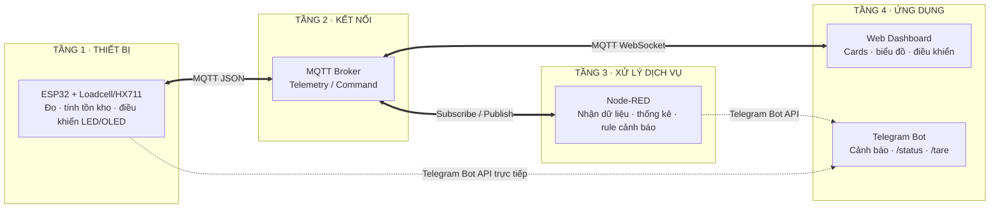

# 📑 TÀI LIỆU TỔNG HỢP KIẾN TRÚC HỆ THỐNG IOT VÀ DANH SÁCH THIẾT BỊ (BOM)

> **Dự án:** Hệ thống Giám sát & Điều khiển IoT Đa Tầng (ESP32 - MQTT - Web Application)  
> **Tác giả / Nhóm thực hiện:** Nhóm 22  
> **Nền tảng:** PlatformIO / ESP32 / HiveMQ MQTT / Node-RED & Web Dashboard  

---

## 📌 PHẦN A: KIẾN TRÚC HỆ THỐNG IoT 4 TẦNG



Mô hình có bốn tầng: ESP32 đo lường và điều khiển tại kệ; MQTT vận chuyển telemetry/lệnh; Node-RED xử lý dữ liệu và là đầu mối duy nhất gửi cảnh báo tồn kho qua Telegram; dashboard và Telegram cung cấp giao diện. Firmware có thể dùng Telegram để nhận lệnh `/status` và `/tare`.

### 1. TẦNG THIẾT BỊ – ESP32
Firmware đọc loadcell qua HX711, tính khối lượng và số lượng, điều khiển LED/OLED, gửi telemetry lên `nhom22/smartshelf/telemetry` và nhận lệnh từ `nhom22/smartshelf/cmd`. Nếu có cấu hình secrets, firmware xử lý `/start`, `/help`, `/status`, `/tare K01` đến `/tare K10`; cảnh báo thiếu hàng do Node-RED gửi để tránh trùng tin.

### 2. TẦNG KẾT NỐI – MQTT BROKER
Firmware, Node-RED và dashboard mặc định cùng dùng HiveMQ Public (ESP32/Node-RED TCP 1883; web WSS 8884). Mosquitto trong Docker chỉ chạy khi bật profile `local-broker`; bật profile không tự chuyển các client sang broker local. HiveMQ Public phù hợp demo, không cung cấp quyền riêng tư cho topic công khai.

### 3. TẦNG XỬ LÝ DỊCH VỤ – NODE-RED
Node-RED nhận telemetry cho K01–K10, tính thống kê, cập nhật giao diện, tạo cảnh báo Telegram và publish lệnh MQTT. Inject mô phỏng giao dịch không chạy tự động; chỉ bấm thủ công khi cần demo để tránh ghi đè dữ liệu cảm biến.

### 4. TẦNG ỨNG DỤNG – WEB VÀ TELEGRAM
Dashboard hiển thị trạng thái, biểu đồ và cung cấp thao tác điều khiển qua MQTT. Telegram nhận cảnh báo và hỗ trợ tra cứu/hiệu chuẩn nhanh. Hai thành phần này là giao diện người dùng của hệ thống.

---

## 🛒 PHẦN B: DANH SÁCH THIẾT BỊ CẦN MUA (BOM) & LINK TRỰC TIẾP
*(Dành cho toàn bộ dự án Kệ hàng thông minh - Smart Shelf khớp 100% mã nguồn)*

| STT | Thiết bị & Thông số kỹ thuật | Số lượng | Giá tham khảo | Link chi tiết thiết bị | Link mua thẳng trên Shopee |
| :---: | :--- | :---: | :---: | :--- | :--- |
| **1** | **Kit ESP32 NodeMCU-32S / DevKit V1**<br>*(Chip kép Wi-Fi + BLE, 30 hoặc 38 chân)* | 1 mạch | ~95.000đ | [Xem chi tiết Mạch ESP32](https://nshopvn.com/product/module-wifi-bluetooth-mini-d1-esp32-wroom-32/) | [🛒 Mua ESP32 trên Shopee (NShop)](https://shopee.vn/dientunshop?keyword=esp32) |
| **2** | **Cảm biến tải trọng Loadcell 5kg**<br>*(Đo khối lượng từng kệ hàng K1, K2, K3)* | 3 cái | ~40.000đ / cái | [Xem chi tiết Loadcell 5kg](https://nshopvn.com/product/cam-bien-can-nang-loadcell/) | [🛒 Mua Loadcell trên Shopee](https://shopee.vn/dientunshop?keyword=loadcell) |
| **3** | **Module khuếch đại ADC 24-bit HX711**<br>*(Đọc tín hiệu vi sai từ Loadcell vào ESP32)* | 3 mạch | ~18.000đ / cái | [Xem chi tiết Module HX711](https://nshopvn.com/product/mach-chuyen-doi-adc-24bit-loadcell-hx711/) | [🛒 Mua HX711 trên Shopee](https://shopee.vn/dientunshop?keyword=hx711) |
| **4** | **Combo Loadcell 5kg + Khung bàn cân Mica**<br>*(Có 2 tấm mica và ốc vít để làm mặt kệ - rất tiện)* | Khuyên dùng | ~75.000đ / bộ | [Xem Combo Loadcell Mica](https://nshopvn.com/product/bo-cam-bien-can-nang-loadcell-5kg-khung-ban-can-mica/) | [🛒 Mua Bàn cân Mica Shopee](https://shopee.vn/search?keyword=b%E1%BB%99%20c%C3%A2n%20mica%20loadcell%205kg) |
| **5** | **Màn hình OLED 0.96 inch I2C (SSD1306)**<br>*(Độ phân giải 128x64, ánh sáng Trắng/Xanh)* | 1 cái | ~45.000đ | [Xem chi tiết OLED 0.96 inch](https://nshopvn.com/product/kit-thu-phat-wifi-esp32-ble-tich-hop-oled/) | [🛒 Mua OLED 0.96 trên Shopee](https://shopee.vn/dientunshop?keyword=oled%200.96) |
| **6** | **LED đỏ 5mm + điện trở 220Ω (hoặc 330Ω)**<br>*(Tối đa 10 đèn cảnh báo, mỗi kệ một GPIO)* | 1 túi | ~12.000đ | [Xem chi tiết LED 5mm](https://nshopvn.com/product/led-5mm-sieu-sang/) | [🛒 Mua LED + Trở trên Shopee](https://shopee.vn/dientunshop?keyword=led%205mm) |
| **7** | **Breadboard MB-102 (Bo cắm thử nghiệm 830 lỗ)** | 1 cái | ~28.000đ | [Xem chi tiết Breadboard](https://nshopvn.com/product/mach-nguon-cho-testboard-breadboard-mb-102-830/) | [🛒 Mua Breadboard trên Shopee](https://shopee.vn/dientunshop?keyword=breadboard%20mb102) |
| **8** | **Tép Dây cắm Breadboard Dupont 20cm**<br>*(Gồm tép Đực - Cái và Đực - Đực)* | 2 tép | ~15.000đ / tép | [Xem chi tiết Dây Dupont](https://nshopvn.com/product/day-cam-test-board/) | [🛒 Mua Dây cắm trên Shopee](https://shopee.vn/dientunshop?keyword=d%C3%A2y%20c%E1%BA%AFm%20breadboard) |
| **9** | **Cáp nạp dữ liệu USB (Micro-USB hoặc Type-C)** | 1 sợi | ~20.000đ | [Xem chi tiết Cáp nạp USB](https://nshopvn.com/product/cap-sac-micro-usb-1m/) | [🛒 Mua Cáp nạp USB Shopee](https://shopee.vn/dientunshop?keyword=c%C3%A1p%20micro%20usb) |

> 💰 **Tổng chi phí dự kiến cho toàn bộ dự án Kệ thông minh:** khoảng **~350.000đ - 420.000đ**.

---

## 🔌 PHẦN C: SƠ ĐỒ CHÂN ĐẤU NỐI 10 KỆ HÀNG (PINOUT WIRING) KHỚP VỚI MÃ NGUỒN

Dựa theo cấu hình chuẩn hóa định nghĩa trong [`src/main.cpp`](file:///c:/Users/boy/Documents/PlatformIO/Projects/tesst/src/main.cpp) và mô phỏng [`diagram.json`](file:///c:/Users/boy/Documents/PlatformIO/Projects/tesst/diagram.json):

```
+-----------------------------------------------------------------------------------+
|               SƠ ĐỒ CHÂN ESP32 ĐIỀU KHIỂN 10 KỆ HÀNG TẠP HÓA 4.0                  |
+-----------------------------------------------------------------------------------+
  [Wokwi: 10 OLED SSD1306 trên bus I2C với địa chỉ mô phỏng 0x30–0x39]
    - Đường nguồn: VCC nối chung 3.3V, GND nối chung GND
    - Đường tín hiệu: SDA nối chung GPIO 21, SCL nối chung GPIO 22
    - Phần cứng thật: dùng 2 bộ TCA9548A (0x70: K01–K08, 0x71: K09–K10), mỗi OLED địa chỉ 0x3C trên một kênh riêng; đặt OLED_USE_TCA9548A=1 trong secrets.h.

  [Đường Xung Nhịp Chung cho Toàn bộ 10 Cảm biến HX711]
    - SCK của CẢ 10 MODULE HX711 ---> Nối chung vào chân GPIO 18 (Clock Bus Daisy-Chain)

  [Bảng Đấu Nối 10 Kệ Hàng: Cảm biến Tải trọng, Màn hình OLED ESL & LED Cảnh báo]
    +-----+--------------------+-------------+------------+--------------+-----------------------+
    | Kệ  | Tên Sản Phẩm       | I2C OLED*   | Chân DT    | Chân LED (+) | Ghi chú Trở hạn dòng  |
    +-----+--------------------+-------------+------------+--------------+-----------------------+
    | K01 | Coca-Cola 330ml    | 0x30 (OLED1)| GPIO 19    | GPIO 2       | Nối tiếp 220Ω về GND  |
    | K02 | Mì Hảo Hảo Tôm     | 0x31 (OLED2)| GPIO 5     | GPIO 4       | Nối tiếp 220Ω về GND  |
    | K03 | Bánh Oishi Phồng   | 0x32 (OLED3)| GPIO 23    | GPIO 27      | Nối tiếp 220Ω về GND  |
    | K04 | Sữa tươi Vinamilk  | 0x33 (OLED4)| GPIO 17    | GPIO 14      | Nối tiếp 220Ω về GND  |
    | K05 | Bột giặt OMO 800g  | 0x34 (OLED5)| GPIO 16    | GPIO 12      | Nối tiếp 220Ω về GND  |
    | K06 | Dầu ăn Simply 1L   | 0x35 (OLED6)| GPIO 32    | GPIO 13      | Nối tiếp 220Ω về GND  |
    | K07 | Nước mắm Nam Ngư   | 0x36 (OLED7)| GPIO 36(VP)| GPIO 15      | Nối tiếp 220Ω về GND  |
    | K08 | Bánh Chocopie Hộp  | 0x37 (OLED8)| GPIO 34    | GPIO 25      | Nối tiếp 220Ω về GND  |
    | K09 | Trứng gà Ba Huân   | 0x38 (OLED9)| GPIO 35    | GPIO 26      | Nối tiếp 220Ω về GND  |
    | K10 | Tương ớt Chinsu    | 0x39(OLED10)| GPIO 39(VN)| GPIO 33      | Nối tiếp 220Ω về GND  |
    +-----+--------------------+-------------+------------+--------------+-----------------------+

  [Đấu dây 4 màu của Cảm biến Loadcell vào Mạch ADC HX711]
    - Dây Đỏ (Red)     ---> E+ (Excitation +)
    - Dây Đen (Black)   ---> E- (Excitation -)
    - Dây Trắng (White) ---> A- (Signal -)
    - Dây Xanh (Green)  ---> A+ (Signal +)
+-----------------------------------------------------------------------------------+
```

*Các địa chỉ 0x30–0x39 trong bảng chỉ là cấu hình mô phỏng Wokwi. Mạch vật lý dùng 2 bộ TCA9548A (mỗi bộ 8 kênh): K01–K08 ở kênh 0–7 của bộ 0x70, K09–K10 ở kênh 0–1 của bộ 0x71; mọi màn hình cùng địa chỉ 0x3C.*

---

## 💡 MẸO MUA HÀNG GOM CHUNG GIỎ TIẾT KIỆM SHIP
1. Vào trực tiếp gian hàng Shopee của **Điện Tử NShop**: [👉 Shopee dientunshop](https://shopee.vn/dientunshop) hoặc **Linh Kiện Cầu Giấy**: [👉 Shopee linhkiencaugiay](https://shopee.vn/linhkiencaugiay).
2. Dùng ô **"Tìm kiếm trong shop"**, gõ tên từng linh kiện trong bảng trên và bấm **Thêm vào giỏ hàng**.
3. Gom đủ danh sách rồi tiến hành thanh toán 1 lần:
   * Chỉ mất **1 lần tiền ship** (thường từ 16k–25k).
   * Áp được mã giảm giá sinh viên và voucher **Freeship Xtra** của Shopee.

---

## 💻 PHẦN E: HƯỚNG DẪN SỬ DỤNG WEB DASHBOARD (PART 3)

Web Server App hoàn chỉnh đã được tạo sẵn trong thư mục [`web/`](file:///c:/Users/boy/Documents/PlatformIO/Projects/tesst/web/index.html):
* **[index.html](file:///c:/Users/boy/Documents/PlatformIO/Projects/tesst/web/index.html):** Giao diện chính Dark Mode / Glassmorphism.
* **[style.css](file:///c:/Users/boy/Documents/PlatformIO/Projects/tesst/web/style.css):** Bảng màu thiết kế cao cấp, hiệu ứng micro-animations.
* **[app.js](file:///c:/Users/boy/Documents/PlatformIO/Projects/tesst/web/app.js):** Xử lý kết nối MQTT WebSocket HiveMQ, Chart.js, lưu LocalStorage và gửi lệnh điều khiển.

### Cách chạy trang Web:
1. Bạn chỉ cần **nhấp đúp chuột** vào file [`web/index.html`](file:///c:/Users/boy/Documents\PlatformIO\Projects\tesst\web\index.html) để mở trên Google Chrome / Edge (không cần cài thêm Web server).
2. Trang web sẽ tự động kết nối với HiveMQ Public Broker qua đường truyền WebSocket Secure (`wss://broker.hivemq.com:8884/mqtt`).
3. Nếu chưa cắm mạch ESP32 thật, bấm nút **"Bật Giả lập (Demo)"** ở góc trên bên phải để kích hoạt mô phỏng gói tin cảm biến nhảy số tự động, vẽ biểu đồ và phân tích dữ liệu phục vụ thuyết trình hoặc quay video demo!

---

## 🏪 PHẦN F: MÔ HÌNH MỞ RỘNG 10 KỆ HÀNG TẠP HÓA THÔNG MINH (POC 50 SẢN PHẨM)

> **Ứng dụng thực tiễn:** Quản lý hàng tồn kho tự động cho tiệm tạp hóa quy mô 50 sản phẩm với màn hình hiển thị giá và cảnh báo tại chỗ (ESL).

### 1. Kiến trúc phân cụm (Cluster Architecture):
* Không dùng 50 bo ESP32 bắt Wi-Fi riêng lẻ (gây nghẽn router và tốn nguồn).
* Hệ thống phân thành **10 Phân khu / Kệ chính**, mỗi cụm quản lý nhóm hàng hóa đại diện:
  $$\text{10 Cụm Kệ} \times \text{5 Ngăn sản phẩm} = \text{50 Mặt hàng}$$

### 2. Danh mục 10 mặt hàng mô phỏng PoC:
1. **K01 - Đồ uống:** Coca-Cola 330ml (330g, Min: 3 lon) - *Mô phỏng Wokwi*
2. **K02 - Ăn liền:** Mì Hảo Hảo Tôm (75g, Min: 5 gói) - *Mô phỏng Wokwi*
3. **K03 - Bánh kẹo:** Bánh Oishi Phồng Tôm (50g, Min: 4 gói) - *Mô phỏng Wokwi*
4. **K04 - Sữa tươi:** Sữa tươi Vinamilk 180ml (190g, Min: 4 hộp) - *ESP32/HX711; có thể mô phỏng thủ công*
5. **K05 - Hóa phẩm:** Bột giặt OMO Comfort 800g (800g, Min: 2 túi) - *ESP32/HX711; có thể mô phỏng thủ công*
6. **K06 - Gia vị:** Dầu ăn Simply 1L (920g, Min: 3 chai) - *ESP32/HX711; có thể mô phỏng thủ công*
7. **K07 - Gia vị:** Nước mắm Nam Ngư 500ml (550g, Min: 3 chai) - *ESP32/HX711; có thể mô phỏng thủ công*
8. **K08 - Bánh kẹo:** Bánh Chocopie Hộp 6 cái (198g, Min: 2 hộp) - *ESP32/HX711; có thể mô phỏng thủ công*
9. **K09 - Thực phẩm:** Trứng gà Ba Huân 10 quả (600g, Min: 2 vỉ) - *ESP32/HX711; có thể mô phỏng thủ công*
10. **K10 - Gia vị:** Tương ớt Chinsu 250g (280g, Min: 3 chai) - *ESP32/HX711; có thể mô phỏng thủ công*

### 3. Phối hợp mô phỏng Hybrid:
* **Wokwi (Interactive):** Sơ đồ hiện tại có đủ 10 cảm biến HX711, OLED và LED cảnh báo. Dữ liệu là mô phỏng Wokwi, không phải số đo phần cứng vật lý.
* **Node-RED Engine:** Nhận telemetry K01..K10; sự kiện mua/nhập hàng chỉ chạy khi bấm inject mô phỏng.
* **Web Dashboard:** Hiển thị trọn vẹn Lưới 10 Kệ hàng (Grid), bộ lọc danh mục, biểu đồ thời gian thực 10 đường và các nút bấm tương tác nhanh.


